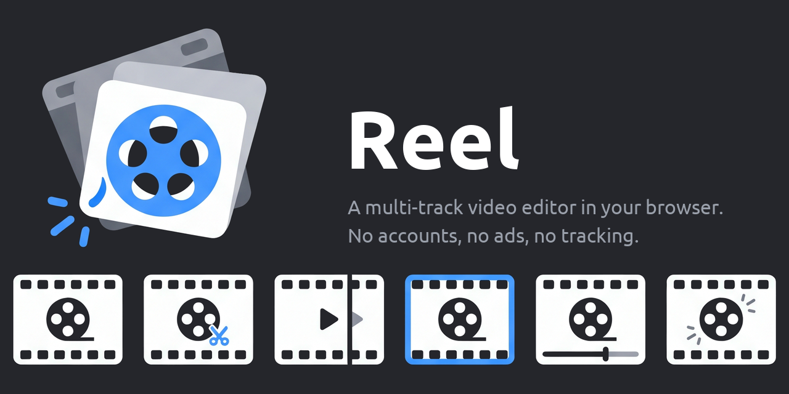

# reel-web



**Try it: https://madebytokens.github.io/reel-web/**

A multi-track video editor that runs entirely in the browser.
No server, no accounts, no ads, no analytics: videos never leave the device.
Hosted as a static site on GitHub Pages and installable to a tablet's Home Screen.

Sister project: [flipbook-web](https://github.com/MadeByTokens/flipbook-web) (frame-by-frame animation).

## Design principle: familiar to KineMaster users

Someone who already edits in KineMaster should be able to sit down and work without
relearning: the preview is at the top, the tools are on the right, the timeline scrolls
under a fixed playhead, and things are called what they are called there (Media, Layer,
Audio, REC, Trim / Split, Mixer, Alpha (Opacity), Save as Video). What was learned about
its interface, with a source for each fact, is in
[docs/kinemaster-conventions.md](docs/kinemaster-conventions.md).

It does not mean copying its artwork, icons, name or styling; the look is our own.

## What works today

- **Projects**: create (seven aspect ratios), rename, duplicate, delete; everything is saved
  on the device as you edit.
- **Main track**: add videos and pictures; they play one after another with no gaps.
- **Layers**: pictures, videos and text over the main track, each on its own row. Move,
  resize and turn them directly on the preview, with one finger or two.
- **Audio**: music and sound files below the layers, a microphone recording (REC), and the
  sound of every video.
- **Timeline**: scroll to move the playhead, pinch to zoom, tap to select, drag the yellow
  grips to trim, press and hold then drag to move a clip or change the order.
- **Clip options**: Trim / Split (trim to the left or right of the playhead, split at the
  playhead), Mixer (volume, mute, fade in and out), Speed (0.25x to 8x), Rotate / Mirror,
  Fit / Fill, Alpha (Opacity), Bring Forward / Send Backward, Duplicate, Delete.
- **Text**: font, size, bold, alignment, colour, outline and background box.
- **Undo and redo** for every edit.
- **Export**: MP4 (H.264 video, AAC sound where the browser has an AAC encoder) at 360p to
  1080p, 15 to 30 frames per second, with a quality slider. Rendered frame by frame, so the
  result is exact however slow the device is.
- **Project file**: one `.reel` file holding a project and its media, for backup or for
  moving to another device.
- **Offline**: after the first visit the app opens with no network.

Not there yet (see [docs/PRD.md](docs/PRD.md)): keyframe animation, transitions, chroma key,
blend modes, colour filters, stickers and handwriting, reverse, 4K.

## How it works

| Part | How |
|---|---|
| Project | A small JSON edit list (`src/doc/`): clips with a source file, in-point, length, speed, position and style. Source files are never changed. |
| Storage | Imported files are copied into the browser's origin private file system, one folder per project. The project itself is written alternately to two slots with a checksum, so a write that is cut short never loses the previous copy. |
| Preview | One muted `<video>` per nearby clip is kept in step with the playhead and painted, with pictures and text, on a 2D canvas (`src/render/compose.ts`). |
| Sound | Decoded a little ahead of the playhead with [Mediabunny](https://mediabunny.dev) and WebCodecs, and scheduled on one Web Audio context whose clock drives the picture. |
| Export | The same compositor, fed exact frames from the decoder, encodes with WebCodecs; sound is mixed with an offline audio context; Mediabunny writes the file straight to storage. |

## Known limits

- The browser must be able to play a file for it to be used. HDR footage is shown however
  the browser converts it.
- Speed changes the pitch of sound.
- Layers stay at their own times when main-track clips before them are trimmed or removed.
- A project file is limited to 4 GB.
- A project can be open in one tab at a time; a second tab is told so.
- Timeline thumbnails and paused frames come from the browser's own video player, so a file
  it cannot seek in shows plain blocks.
- Export pauses if the app goes to the background, and needs the screen to stay on (the app
  asks the browser to keep it awake).
- Browsers may clear a site's files after some weeks without use unless the app has been
  added to the Home Screen.
- The preview has not been measured on a tablet yet; the menu's **Performance stats** shows
  what it is doing there.

## Development

```sh
npm install
npx playwright install webkit chromium   # once, and after Playwright upgrades
npm run dev      # dev server
npm run check    # type-check, unit tests, build, browser tests
npm run shots    # only the screenshot run; pictures land in test-results/shots
```

Storage and offline use need HTTPS or localhost, so test on a tablet with the deployed site.

| Path | What |
|---|---|
| `src/app.ts` | Start-up, screens, keyboard, menus |
| `src/editor.ts` | The open project: edits, undo, selection, saving |
| `src/doc/` | Project model and every edit operation (pure functions, unit-tested) |
| `src/media/` | Media library, preview player, sound, export |
| `src/render/` | The compositor shared by preview and export |
| `src/store/` | Storage on the device |
| `src/ui/` | Timeline, tool panel, preview handles, dialogs |
| `src/features/` | Projects screen, export dialog, recording |
| `tests/e2e/` | Browser tests; `tests/fixtures/` are generated test clips |
| `scripts/` | `real-session.mjs` (a manual run with real footage), `check-live.mjs` (checks the published site), `make-brand.py` |

The app icons, favicon and banner are cut from one picture, `docs/brand/sheet.jpeg`, by
`python scripts/make-brand.py` (needs Pillow, NumPy and SciPy). The sheet was made with an
image generator; the banner's text is added by the script.
